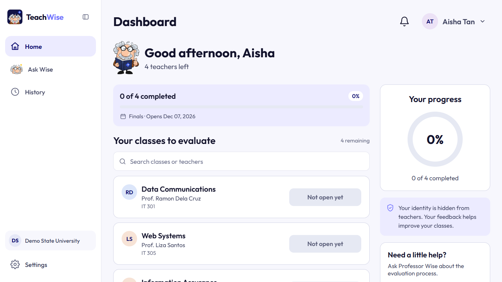
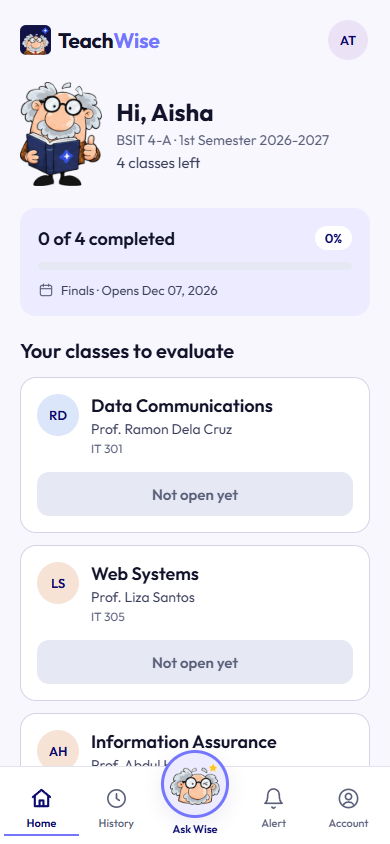
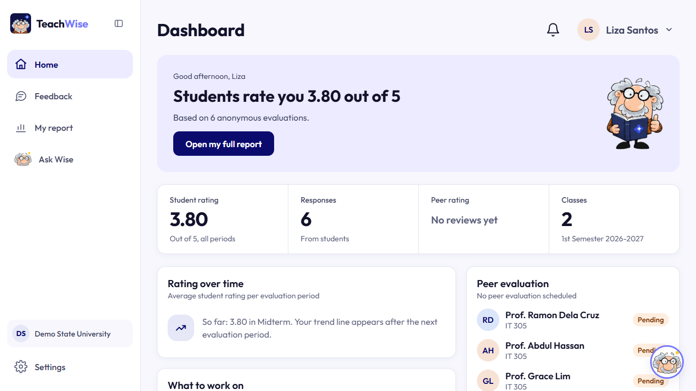
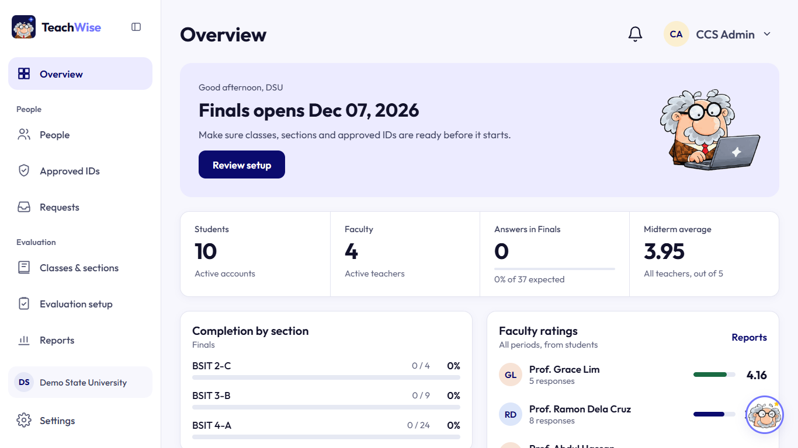

# TeachWise

**[Live demo](https://teachwise-demo.onrender.com)** · one-click Student, Teacher, School admin and Owner demo accounts on the sign-in screen (free hosting: the first visit can take about a minute to wake up).

Anonymous instructional evaluation for schools, on **Android** and the **web**, guided by **Professor Wise**, a friendly cartoon professor who walks everyone through it.

Students rate their teachers in about three minutes per class. Teachers get clear, anonymous results with trends, focus areas and comments. Admins run the whole process from one dashboard. One app and one server serve **many schools**, and each school's data is kept strictly separate.





| Teacher dashboard | School-admin dashboard |
|---|---|
|  |  |

## Features

**For students**
- Join with the school's code, link or a search, then sign up with an approved student ID
- See every class to evaluate in the open period, with progress and due dates
- Step-by-step rating form (1–5 plus optional comments) with saved drafts that survive going offline
- Answers are anonymous: teachers never see who said what, and nothing links back after an account is deleted

**For teachers**
- Dashboard with overall rating, trend over time, strongest areas and areas to focus on
- Anonymous comments, shown only once enough students have answered (the school sets the minimum)
- Peer evaluation of active colleagues in the same assigned department, if the school turns it on; teachers without a department must ask their admin for an assignment
- Full report with **Print / Save as PDF**, or a short summary to share from a phone

**For school admins**
- School profile, departments, programs, dean accounts and administrator invitations
- Shared questionnaires, rating scales, semesters and evaluation dates, with automatic opening/closing notifications
- School-wide read-only reports, activity and administrator account requests
- Explicit, audited department transfers with previous evaluations preserved

**For department deans**
- Own department's teachers, students, approved IDs, teacher invitations and account requests
- Subjects, sections and semester-specific class assignments, including spreadsheet imports
- Own department's read-only results, reports and participation reminders
- Read-only shared questionnaire and school calendar; submitted results cannot be changed by either role

See [administrator responsibilities](docs/ADMIN-RESPONSIBILITIES.md) for the permission matrix and verification.

**For the TeachWise owner**
- Approve, pause or remove schools that apply from the app
- Inbox for messages from school admins and an app health page; the owner never sees evaluation answers

**Throughout**
- English and Filipino, light and dark mode, accessible labels, keyboard shortcuts on computers
- Compact desktop navigation; mobile bottom tabs for students and teachers, with a left navigation drawer for school admins and deans
- Works offline with cached data; push notifications on Android
- Professor Wise offers contextual AI guidance with Ollama: evaluation help, constructive feedback, study habits, teaching strategies and supportive conversation

### Account matching and evaluation assignments

Students can sign up only after the school supplies their approved name and section. Department admins assign teachers and subjects to a course/year/section and semester; matching teacher–subject pairs automatically appear on student Home for the school's active semester. Home displays that section and semester and refreshes assignments every 30 seconds. Assignments without a semester stay off student Home. Staff join through one-time invitations whose school-supplied identity, role and department are enforced by the API. Teacher peer evaluation stays strictly within their assigned department, even when colleagues teach different subjects. BSED and BSIT should be configured as separate departments if they require separate peer groups. Both roles need an open evaluation period. See [the account and assignment review](docs/ACCOUNT-ASSIGNMENT-REVIEW.md) for verification evidence and local setup still required.

### Professor Wise AI setup

Install Ollama on the API server and run `ollama pull gemma3:4b`. In `backend/.env`, set `OLLAMA_ENABLED=true`, `OLLAMA_ENDPOINT=http://127.0.0.1:11434` and `OLLAMA_MODEL=gemma3:4b`, then run `php artisan migrate` and `php artisan config:clear`. Start MySQL in XAMPP before using TeachWise. `start-teachwise.bat` starts the standard local Ollama installation when needed and runs `php artisan wise:check` to report missing services, schema updates or models. Ollama must stay running. Use `php artisan wise:check --warm` to preload it before the first conversation. The endpoint is reached by Laravel, not by the student's phone. A hosted API needs its own reachable Ollama service; a developer's localhost is not accessible to it.

Wise generates substantive replies with Ollama. Simple greetings and thank-yous use a fast local acknowledgement without loading the model or querying evaluation statistics. Its reviewed guidance and product knowledge live in `backend/app/Support/WisePrompt.php`. It receives verified role-specific data plus up to 12 recent turns from the selected conversation (bounded by context size). Long feedback is shortened before entering the context; very long multilingual questions can expand the model context window. Wise is an AI guidance assistant, not a licensed counselor. Teacher details remain hidden below the school's minimum response threshold.

Laptop and desktop chat pages use a narrow app-navigation rail, one conversation sidebar, and a readable chat column. The 72-pixel app rail stays compact across all desktop pages with no expand/collapse control. Page changes use a subtle 200-millisecond fade and settling motion, respecting reduced-motion settings. Phones, tablets and compact floating panels use the menu beside Professor Wise. Both contain **New conversation**, **History**, **Settings** and **Delete this conversation**. Each topic has its own messages and model context. Topic titles come from the first substantive message after a greeting; no extra title-generation model call is needed. History and earlier messages can be paged. Existing messages are preserved as an earlier conversation when the conversation migration runs. Deleting a topic preserves other chats and evaluations. The selected numeric topic ID survives browser refresh in session storage, while titles and conversation text are excluded from persistent device caching. Chats remain saved to the account until deleted and do not automatically train the model. Messages use compact text and render bold emphasis. Wise may use an occasional context-appropriate emoji, while serious or sensitive guidance stays free of decorative emojis.

Message retries reuse a request ID so a lost connection cannot create a duplicate saved turn. Sending and clearing are serialized per user, and question/reply pairs are saved atomically. A truncated model reply is labeled with an invitation to continue. The normal backend test suite never calls live Ollama. Optional real-model API checks run with `php vendor/phpunit/phpunit/phpunit tests/Live/WiseLiveTest.php` using an in-memory SQLite database. Web control checks are in `app/scripts/verify-wise.cjs`; all their API responses are isolated fixtures. The separate `verify-wise-live.cjs` script requires an explicitly configured, isolated demo API so live browser tests do not write to school accounts.

The installed model determines reasoning quality. The default uses Gemma 3 4B; changing the prompt does not upgrade the model itself. Set `OLLAMA_MODEL` to another installed, chat-capable model if the server has sufficient resources. `OLLAMA_TIMEOUT` defaults to 120 seconds and `OLLAMA_MAX_TOKENS` to 700. If the service fails, replies explicitly disclose limited built-in mode; check the Laravel log for the technical cause. The chat API returns `source: ollama` for generated answers, `source: quick` for lightweight greetings/acknowledgements, and `source: rules` for fallback answers.

## Tech stack

- **API:** Laravel 12 (PHP 8.3), Sanctum tokens, MySQL / MariaDB (XAMPP), SQLite for tests
- **App:** React Native + Expo SDK 54 with Expo Router, one codebase for Android and the web
- **Data:** TanStack Query (with offline cache), Zustand
- **CI:** GitHub Actions runs the API tests, an app type check and a web build on every push

## Security and privacy

- Evaluator identities are never sent to teachers; results stay hidden below the school's minimum response count
- Every school's records carry a school ID and are filtered automatically on every request, so one school can never read another's data
- Role and department checks on every admin action; schools can be paused instantly
- Login lockout, rate limits on sign-up and password reset, short or long sessions, sign out of other devices
- Data Privacy Act (RA 10173) ready: privacy notice and consent, download my data, delete my account, audit log
- Records that have evaluation history can't be deleted by accident (they are switched off instead)
- Security headers and hashed one-time codes

## Getting started (Windows + XAMPP)

1. Put the project in `C:\xampp\htdocs\` and start **MySQL** in XAMPP.
2. Install [Node.js LTS](https://nodejs.org) and [Composer](https://getcomposer.org).
3. Double-click **`setup-database.bat`** (first time; it loads the demo data).
4. Double-click **`install-app-packages.bat`**.
5. Double-click **`start-teachwise.bat`**, then open `http://localhost:8081`, or scan the QR code with **Expo Go** on an Android phone.

| Double-click | When |
|---|---|
| `setup-database.bat` | First time, or to reset everything to demo data (erases the database) |
| `update-database.bat` | After getting a new version (keeps your data) |
| `install-app-packages.bat` | After getting a new version that needs new app packages |
| `start-teachwise.bat` | Every time: starts the API and the app |
| `restart-app.bat` | If the app window is stuck or new files don't show up |
| `load-demo-data.bat` | Adds the sample schools and accounts to an existing database |
| `create-owner.bat` | Creates the TeachWise owner account (approves schools) |
| `create-admin.bat` | Creates an admin for a school (or a new school) |

### Demo accounts

Every demo account uses the password `password`.

| Username | Who |
|---|---|
| `owner` | TeachWise owner: approves and pauses schools |
| `admin` | School admin, Demo State University (school code `DEMO`) |
| `ccsdean` | Department admin, College of Computer Studies |
| `lsantos` | Teacher |
| `aisha` | Student |
| `sampleadmin` · `mara` | Admin and student of a second school, Sample Community College (`SAMPLE`) |

Northern Isles College is a demo school application waiting for the owner's approval.

## Project structure

```
backend/                 Laravel 12 REST API
  app/Http/Controllers/  Auth, Student, Teacher, Admin, Platform (owner), school directory
  app/Models/            Users, schools, departments, classes, periods, questions, evaluations
  app/Support/           Tenant (current school) and admin scope helpers
  database/              Migrations and demo seeders
  tests/Feature/         API tests
app/                     Expo app (Android + web)
  src/app/               Screens by role: student/, teacher/, admin/, platform/, plus sign-in and join pages
  src/components/        UI kit, charts, Professor Wise, admin tables and forms
  src/api/  src/auth/    API hooks and sign-in state
  scripts/               Reusable browser and release checks
docs/                    Permissions, assignment flows, responsive review and testing guide
*.bat                    One-click helpers for Windows
DEPLOY.md                Hosting, web app, APK and Google Play
STORE_LISTING.md         Play Store texts (EN/FIL), content rating, data safety answers
```

## Tests

The API suite covers sign-up and roster matching, anonymous student and department peer evaluations, school/dean permissions, historical results, school separation, account identity, and Professor Wise conversations.

```
cd backend
php artisan test
```

Run `npm run typecheck` and `npm run build:web` from `app/` for the frontend checks. See [the testing guide](docs/TESTING.md) for browser checks, isolated fixtures and optional live-model verification.

## Deploying

See **[DEPLOY.md](DEPLOY.md)** for putting the API online, publishing the web app, building the Android app with EAS and submitting it to Google Play, and onboarding new schools.

## Author & License

Built by **Mukramin Bariwa Ansao**. Released under the [MIT License](LICENSE).
