# TeachWise

**[Live demo](https://teachwise-demo.onrender.com)** · one-click Student, Teacher, School admin and Owner demo accounts on the sign-in screen (free hosting: the first visit can take about a minute to wake up).

Anonymous instructional evaluation for schools, on **Android** and the **web**, guided by **Professor Wise**, a friendly cartoon professor who walks everyone through it.

Students rate their teachers in about three minutes per class. Teachers get clear, anonymous results with trends, focus areas and comments. Admins run the whole process from one dashboard. One app and one server serve **many schools**, and each school's data is kept strictly separate.

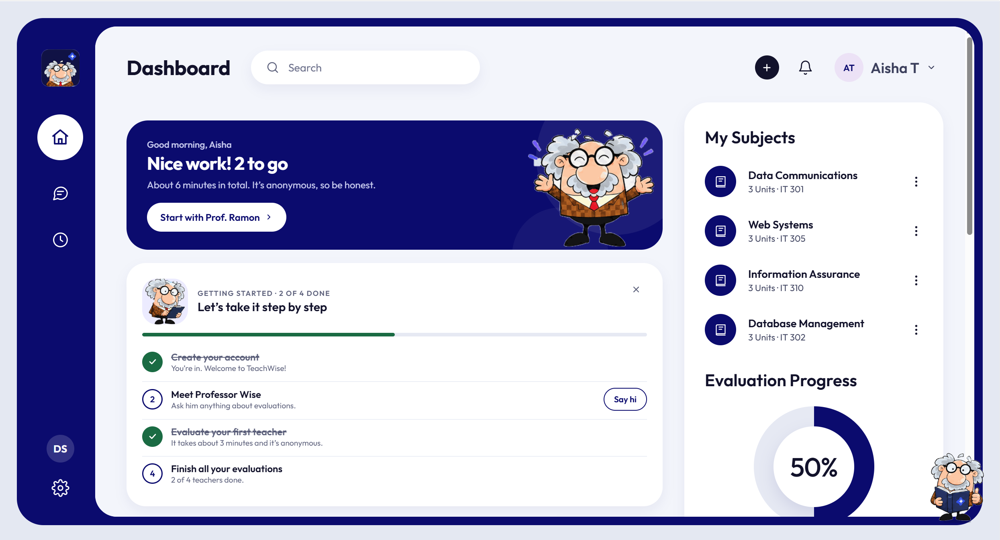

| Rating a teacher | Teacher dashboard |
|---|---|
| 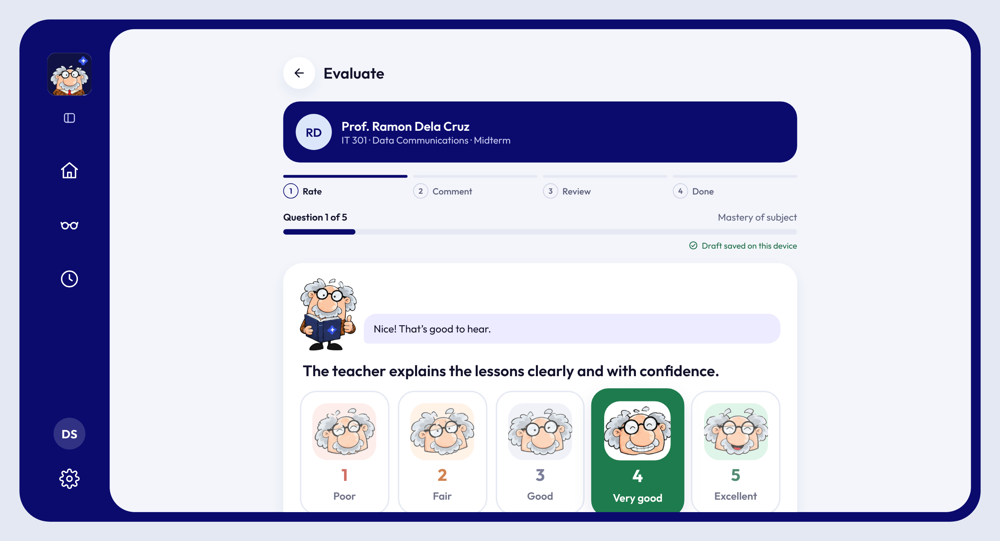 | 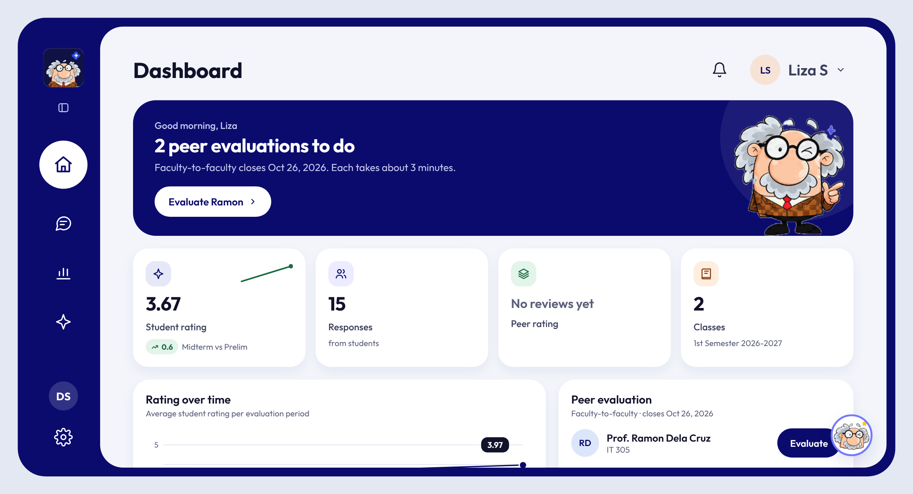 |
| **Faculty report** | **Admin dashboard** |
| 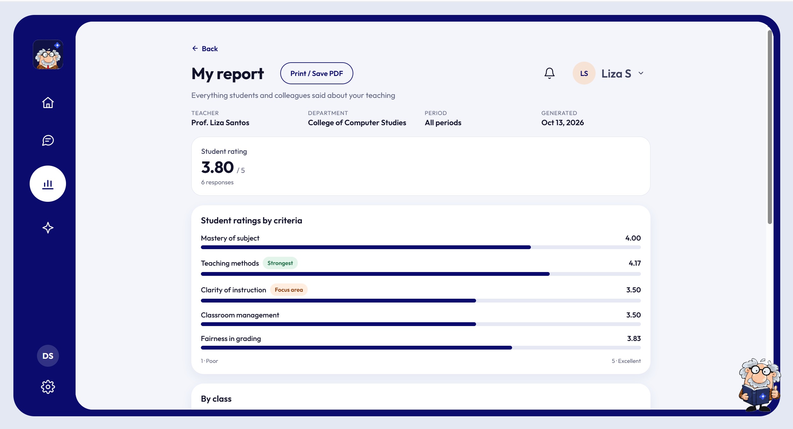 | 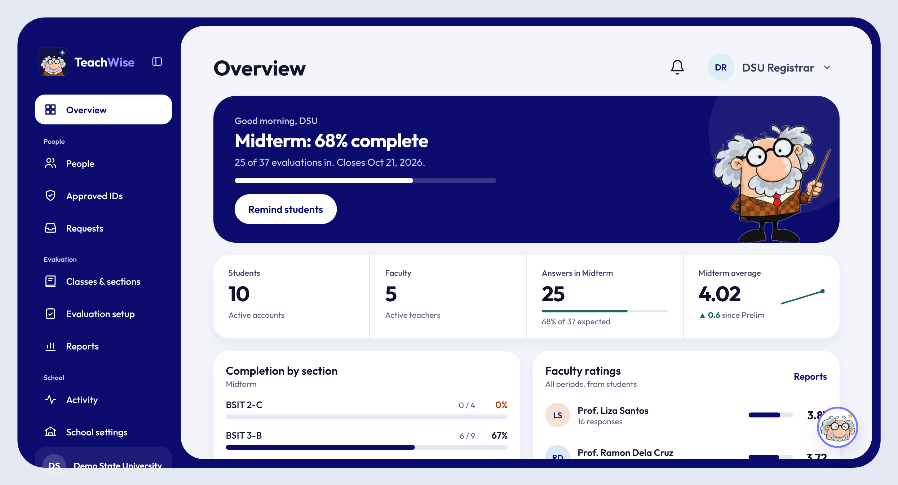 |
| **Evaluation setup** | **People and invites** |
| 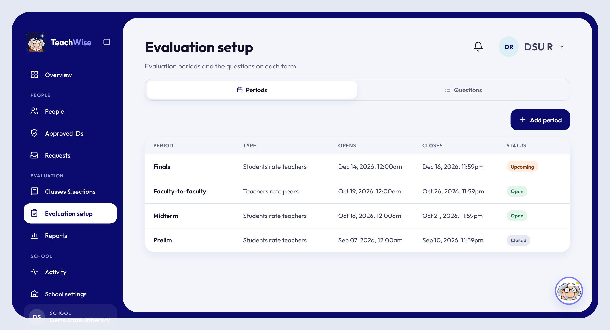 | 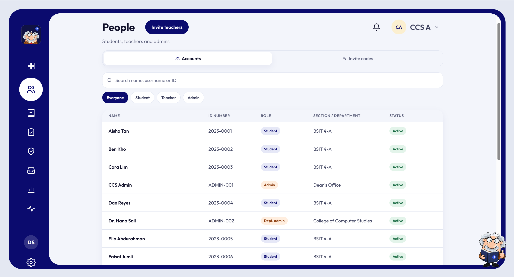 |
| **Sign in (pick your school)** | **Dark mode with Professor Wise** |
| 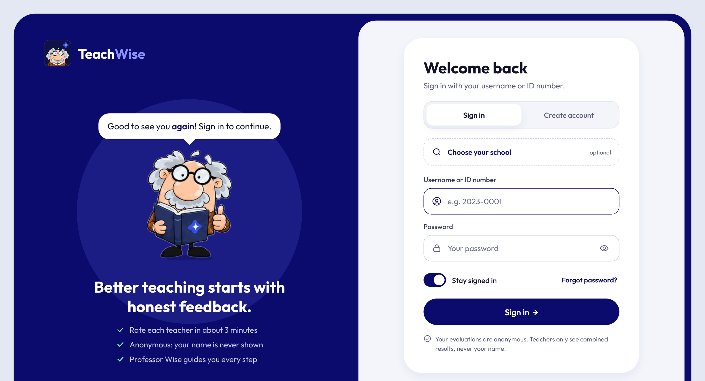 | 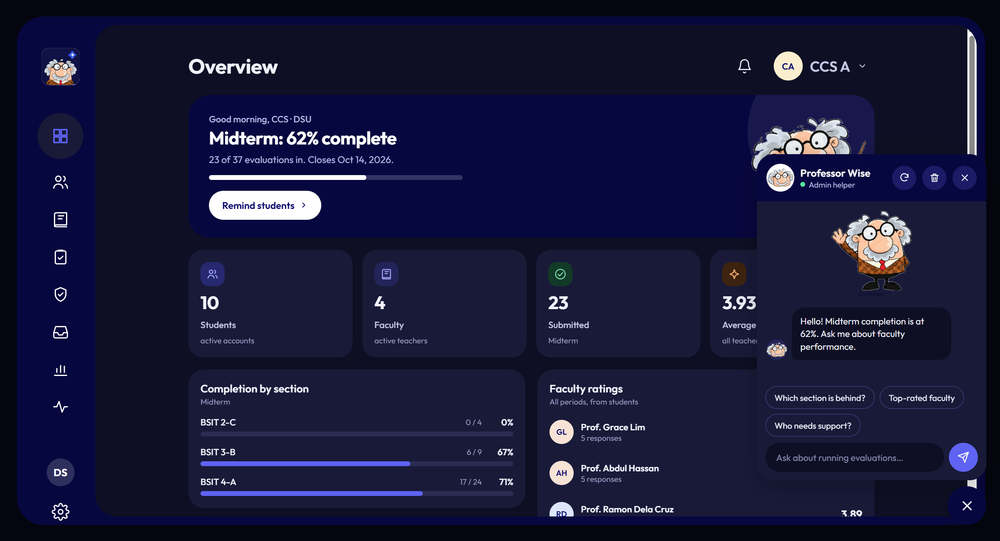 |
| **Professor Wise on a phone** | **Admin on a phone (dark)** |
| 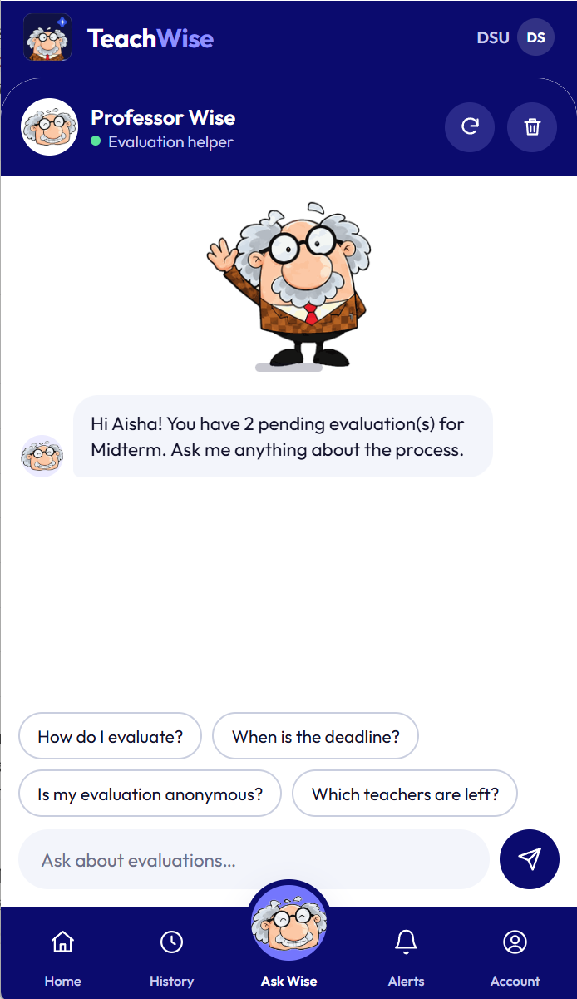 | 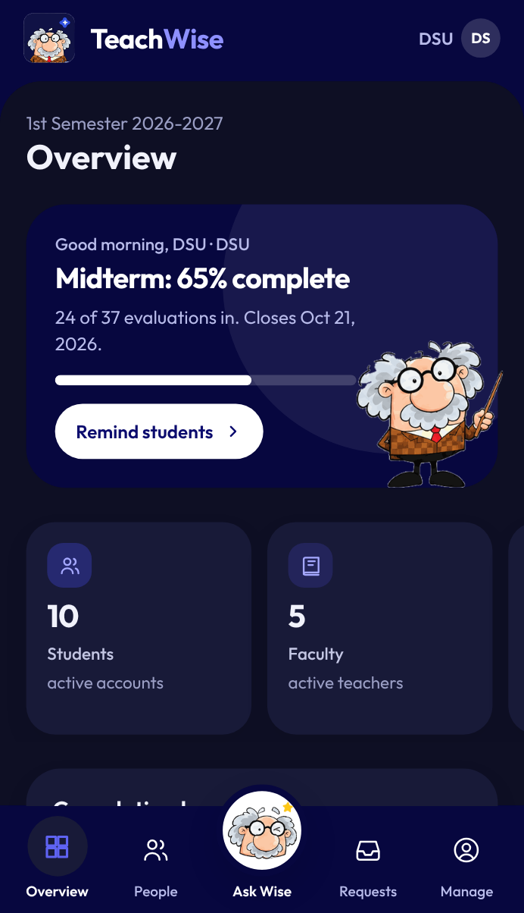 |
| **Owner: TeachWise overview** | **Owner: approving schools** |
| 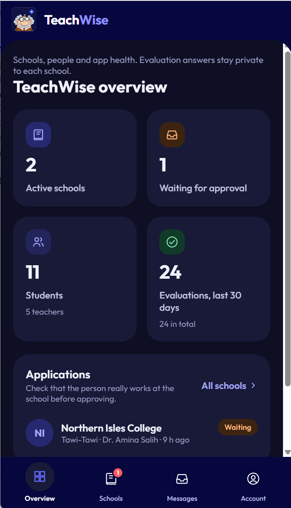 | 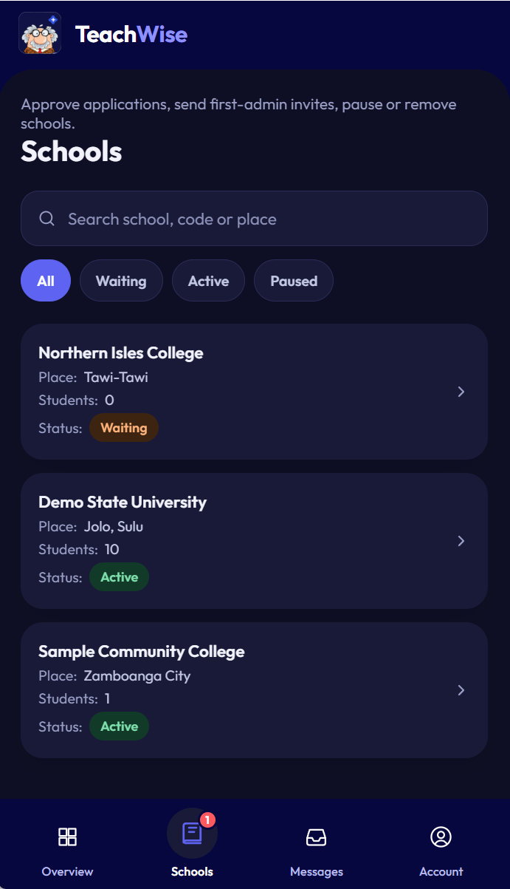 |

## Features

**For students**
- Join with the school's code, link or a search, then sign up with an approved student ID
- See every class to evaluate in the open period, with progress and due dates
- Step-by-step rating form (1–5 plus optional comments) with saved drafts that survive going offline
- Answers are anonymous: teachers never see who said what, and nothing links back after an account is deleted

**For teachers**
- Dashboard with overall rating, trend over time, strongest areas and areas to focus on
- Anonymous comments, shown only once enough students have answered (the school sets the minimum)
- Peer evaluation of colleagues, if the school turns it on
- Full report with **Print / Save as PDF**, or a short summary to share from a phone

**For school admins and deans**
- Departments, programs, sections, subjects and class offerings, plus bulk class assignments pasted from a spreadsheet
- Evaluation periods with automatic "now open" and "closes soon" notifications
- Questions in English and Filipino; the form locks while a period is open so everyone answers the same thing
- Approved student ID lists, staff invite codes, account requests, temporary passwords
- Faculty reports, activity log, school settings (rating labels, term name, peer evaluation, minimum responses, logo)
- Department admins see and manage only their own department

**For the TeachWise owner**
- Approve, pause or remove schools that apply from the app
- Inbox for messages from school admins and an app health page; the owner never sees evaluation answers

**Throughout**
- English and Filipino, light and dark mode, accessible labels, keyboard shortcuts on computers
- Works offline with cached data; push notifications on Android
- Professor Wise answers common questions for each role

## Tech stack

- **API:** Laravel 12 (PHP 8.3), Sanctum tokens, MySQL / MariaDB (XAMPP), SQLite for tests
- **App:** React Native + Expo SDK 54 with Expo Router, one codebase for Android and the web
- **Data:** TanStack Query (with offline cache), Zustand
- **CI:** GitHub Actions runs the API tests, an app type check and a web build on every push

## Security and privacy

- Evaluator identities are never sent to teachers; results stay hidden below the school's minimum response count
- Every school's records carry a school ID and are filtered automatically on every request, so one school can never read another's data
- Role and department checks on every admin action; schools can be paused instantly
- Login lockout, rate limits on sign-up and password reset, short or long sessions, sign out of other devices
- Data Privacy Act (RA 10173) ready: privacy notice and consent, download my data, delete my account, audit log
- Records that have evaluation history can't be deleted by accident (they are switched off instead)
- Security headers and hashed one-time codes

## Getting started (Windows + XAMPP)

1. Put the project in `C:\xampp\htdocs\` and start **MySQL** in XAMPP.
2. Install [Node.js LTS](https://nodejs.org) and [Composer](https://getcomposer.org).
3. Double-click **`setup-database.bat`** (first time; it loads the demo data).
4. Double-click **`install-app-packages.bat`**.
5. Double-click **`start-teachwise.bat`**, then open `http://localhost:8081`, or scan the QR code with **Expo Go** on an Android phone.

| Double-click | When |
|---|---|
| `setup-database.bat` | First time, or to reset everything to demo data (erases the database) |
| `update-database.bat` | After getting a new version (keeps your data) |
| `install-app-packages.bat` | After getting a new version that needs new app packages |
| `start-teachwise.bat` | Every time: starts the API and the app |
| `restart-app.bat` | If the app window is stuck or new files don't show up |
| `load-demo-data.bat` | Adds the sample schools and accounts to an existing database |
| `create-owner.bat` | Creates the TeachWise owner account (approves schools) |
| `create-admin.bat` | Creates an admin for a school (or a new school) |

### Demo accounts

Every demo account uses the password `password`.

| Username | Who |
|---|---|
| `owner` | TeachWise owner: approves and pauses schools |
| `admin` | School admin, Demo State University (school code `DEMO`) |
| `ccsdean` | Department admin, College of Computer Studies |
| `lsantos` | Teacher |
| `aisha` | Student |
| `sampleadmin` · `mara` | Admin and student of a second school, Sample Community College (`SAMPLE`) |

Northern Isles College is a demo school application waiting for the owner's approval.

## Project structure

```
backend/                 Laravel 12 REST API
  app/Http/Controllers/  Auth, Student, Teacher, Admin, Platform (owner), school directory
  app/Models/            Users, schools, departments, classes, periods, questions, evaluations
  app/Support/           Tenant (current school) and admin scope helpers
  database/              Migrations and demo seeders
  tests/Feature/         API tests
app/                     Expo app (Android + web)
  src/app/               Screens by role: student/, teacher/, admin/, platform/, plus sign-in and join pages
  src/components/        UI kit, charts, Professor Wise, admin tables and forms
  src/api/  src/auth/    API hooks and sign-in state
*.bat                    One-click helpers for Windows
DEPLOY.md                Hosting, web app, APK and Google Play
STORE_LISTING.md         Play Store texts (EN/FIL), content rating, data safety answers
```

## Tests

72 API tests (479 assertions) cover sign-up and recovery, anonymous evaluation, teacher privacy rules, admin tools, school separation and publish-readiness checks.

```
cd backend
php artisan test
```

## Deploying

See **[DEPLOY.md](DEPLOY.md)** for putting the API online, publishing the web app, building the Android app with EAS and submitting it to Google Play, and onboarding new schools.

## Author & License

Built by **Mukramin Bariwa Ansao**. Released under the [MIT License](LICENSE).
